<p align="center">
  <picture>
    <source media="(prefers-color-scheme: dark)" srcset="assets/logo-dark.svg">
    
  </picture>
</p>

<p align="center">
  <a href="https://github.com/malakhq/malak/actions/workflows/ci.yml"></a>
  <a href="https://github.com/malakhq/malak/releases/latest"></a>
  <a href="LICENSE"></a>
  
  <a href="https://durative.dev"></a>
  
</p>

# Malak

Malak runs in the background to delegate work across your agents and subagents.
`malak mailbox` gives you a bird's-eye view of the work.
Malak v0.1 runs on macOS and Linux.

Copyright 2026 Olaoluwa Oluro. Licensed under the Apache License 2.0; see LICENSE and NOTICE.

## Documentation

- [Quickstart](docs/QUICKSTART.md)
- [Command examples](docs/EXAMPLES.md)
- [Agent recipes](docs/RECIPES.md)
- [Rust API](#rust-library)
- [Architecture](ARCHITECTURE.md)
- [Contributing](CONTRIBUTING.md)
- [Security](SECURITY.md)

## Start

Follow the [CLI install steps](#cli). Put Python 3.11 or later and a
signed-in Claude Code or Codex on `PATH`.

Run `malak recipe agents` to install the Malak skill and reminders for Claude Code and Codex.

### Make your agent the lead

Open Claude Code or Codex in your project and paste this into the chat.

> Become the Malak lead for this project.

The agent runs `malak recipe lead-up NAME` with the project folder name unless
you give it a board name. It watches that board and passes `--board NAME` on
each board command. Run `malak --board NAME recipe agents-md` from the project
directory to give every chat there Malak instructions.

### Take over as lead

Ask a new Claude Code or Codex chat in the same project.

> Take over as the Malak lead for this project.

The new chat uses the same board name and reads unacknowledged messages on
`lead` first. It then reviews `questions`, orders in force, waiting workers,
and traces for active work. Keep one lead chat for each board.

### Try the demo

Use a fresh default board for the demo.

```console
$ malak board start --detach
Board ready.
```

Open the mailbox in a second terminal.

```console
$ malak mailbox
```

In the first terminal, run the demo and watch it in the mailbox.

```console
$ malak recipe demo claude "Name five different fruits."
```

The demo asks the lead to divide the goal into five tasks. Use
`malak recipe demo codex "GOAL"` to run with Codex and review the four
hooks when prompted. The command shows startup progress and returns once
the lead and workers have started. Read the printed outcome file when the
demo finishes.

The mailbox shows a summary above Participants and the Activity, Questions,
Orders, Waiting, and Trace tabs. Press Tab to switch panes, and press 1–5 or
the bracket keys to switch tabs. Press Enter on a participant to filter
messages they sent or received. Revoked participants are grouped under
Archived (N) at the bottom of Participants. The archive starts closed.
Press `a` to show or hide it. Select an archived participant and press Enter
to filter its message history. Esc clears the filter. Press `?` for help
or `q` to leave.

`--sandbox off` gives the lead and workers full access as your user.

### Try it without an agent

With a board running, send a message to the lead and open the mailbox.

```sh
malak send lead "Hello from Malak."
malak mailbox
```

In Activity, use `e` to toggle message previews. Press Enter on a message
to read its full body. Up and Down scroll the body, and Enter or Esc
returns to the preview. The selected message shows its reply address and,
when present, its trace ID. Press `c` to copy the full address, `y` to copy
the full trace ID, or `t` to open that trace. Esc returns to your selection.

Use `malak mailbox --trace ID` to open the Trace tab directly. It shows
the retained conversation in send order and follows new messages as they
arrive. Add `--plain` to stream message blocks or `--json` to export the
retained messages and exit. The board can assign a trace, replies can
inherit one, and senders can supply one.

Use `malak mailbox --waiting` to find unacknowledged lead messages in
worker inboxes. Add `--for NAME` to review one worker or `--json` for
scripts. The lead's `malak mailbox --plain --for lead` watcher follows `lead`,
`questions`, and `orders`, and emits `stuck` blocks after 15 minutes and hourly
thereafter. Agents use `--next` to wait for the next event from another
participant or a due reminder. It remembers shown messages across runs and
repeats unacknowledged lead mail at most once an hour.
Participant names `lead` and `stuck` are reserved.

## For agents

See the [agent recipes](docs/RECIPES.md) for worker launches, hooks and recovery.
The [recipe overview](docs/RECIPES.md#what-recipes-are) explains how recipes use the board commands.
To follow up on the same trace, select the message in Activity and press
`c`. Pass the three copied values to `--reply-to`.

```sh
malak send --kind task --reply-to CHANNEL CREATION POSITION INBOX "Check the parser too."
```

Use the recipient's inbox for `INBOX`. The reply inherits the trace from
the message the address names.

## Install

### Rust library

Add this to your `Cargo.toml` to embed a board in a Rust program.

```toml
[dependencies]
malak = "0.1.1"
```

The [Rust API example](crates/malak/src/lib.rs) shows how to send, read, and
acknowledge a message on an in-memory board. To open the full API documentation,
run `cargo doc -p malak --no-deps --open` from the checkout.

### CLI

Starting with v0.1.1, install the CLI from crates.io after publication.

```sh
cargo install malak
```

To build from source, run this from the checkout.

```sh
cargo install --locked --path crates/malak
```

Check your installation with `malak --version`.
Building the CLI requires Rust 1.95 or later and a C compiler for bundled SQLite.
The [recipes](docs/RECIPES.md) also need a POSIX shell and Python 3.11 or later.

Malak v0.1 ships the memory, Markdown and SQLite stores. SQLite repair is
unsupported, and the SQLite power-cut evidence comes from simulation.

## Upgrade and uninstall

Run `malak upgrade` to install the latest `vX.Y.Z` release tag with Cargo.
Use `--version X.Y.Z` to select a release or `--path DIR` to build from a
local Malak checkout. Use `--dry-run` to preview the source, connected
workers, board restarts and upgrade notice. Run the upgrade without
`--dry-run` to apply it immediately. Downgrades require `--force`.

Upgrade refreshes the skill and reminders previously installed by
`malak recipe agents` and restarts the boards that were running with their
existing configurations. Connected workers reconnect through their hooks
on the next call. The plan also lists active worker launchers, which retry their
final reports for up to 60 seconds when the board connection drops.
After a build change, upgrade posts the build IDs and lead-facing changes to
each restarted board's `lead` inbox and asks the lead to re-read the Malak skill.
Restart each lead chat's watcher after its board restarts.
If upgrade reports changed reminder hooks, restart existing Claude Code chats
or review and approve the hooks in Codex `/hooks` or **Settings > Hooks**.
`malak board status` shows the served version and build.

If an upgrade is interrupted, run it again against the same target. It
finishes pending agent refreshes and restarts boards that still serve an
older build.

Run `malak uninstall` to stop the boards, list where their data lives and
remove the installed agent integration. Uninstall looks for Cargo in the
binary's install root first, then on `PATH`. After Cargo removes the binary,
uninstall removes symlinks on `PATH` that pointed to it. If the binary or a
symlink needs manual removal, the last line gives the exact `rm` command.
On a terminal, confirm uninstall, then choose whether to delete the listed
board data. The default keeps the data.
Uninstall shows each board's configuration, state and socket folders, with
counts for worker handovers and demo workspaces. The deletion preview lists
the roots to be removed and the exact paths that stay, with reasons. A
matching handover selected by `MALAK_HANDOVER` outside the board folders
appears in the keep list. Find other handovers written with `--out` by hand.

Without a terminal, run `malak uninstall --yes` to keep the data or
`malak uninstall --yes --delete-data` to delete it. Add `--dry-run` to preview
the actions without confirmation or changes. Add `--verbose` to see individual
handovers and managed paths.

## Hooks

`malak recipe worker-start` configures native hooks when it launches
Claude Code or Codex directly. For a separately launched agent, see
[manual hook setup](docs/RECIPES.md#agent-tool-hooks).

---

Keep handover files private. An agent running under the owner's OS account can
sign itself onto the owner's other boards because the owner door trusts that
account. Use separate OS accounts to keep agents apart.
